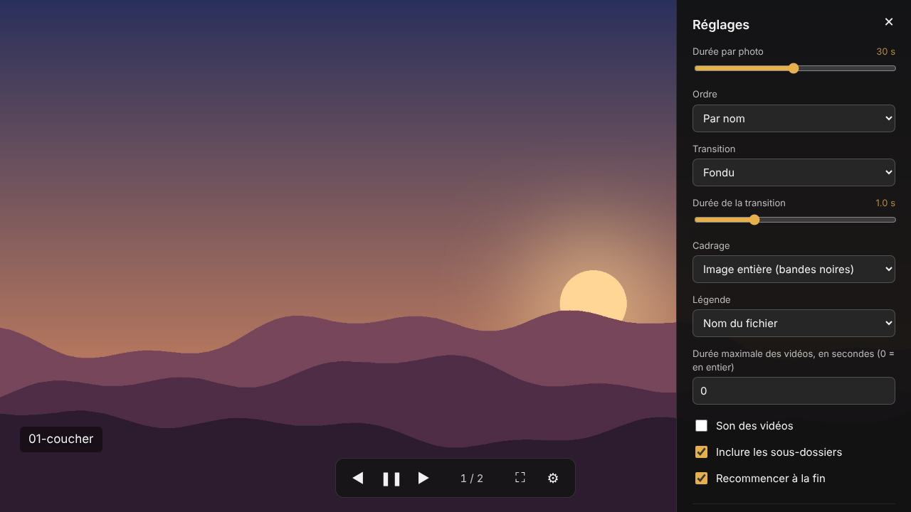

# Diaporama

Diaporama plein écran de photos et vidéos, affiché dans le navigateur.
On lui donne le chemin d'un dossier ; un petit serveur local Python sert la page.
Un seul fichier Python, aucune dépendance.



## Installation (Windows)

1. Installer « Python 3 » depuis le Microsoft Store (une seule fois).
2. Copier `slideshow.py` et `Diaporama.bat` dans le même dossier.

## Lancement

- Glisser un dossier de photos sur `Diaporama.bat`, ou double-cliquer dessus et taper le chemin.
- Ou en ligne de commande :

```
py slideshow.py "C:\Users\Moi\Pictures\Vacances"
```

Le navigateur s'ouvre ; un clic sur « Démarrer » lance le plein écran.

Sur Mac ou Linux : `python3 slideshow.py /chemin/vers/dossier`.

## Options au lancement

| Option | Effet |
| --- | --- |
| `--duree 8` | secondes par photo (défaut : 5) |
| `--ordre nom\|date\|aleatoire` | ordre de défilement |
| `--aleatoire` | raccourci pour `--ordre aleatoire` |
| `--auto` | démarre sans attendre de clic (vidéos muettes) |
| `--reseau` | accessible depuis les autres appareils du réseau local |
| `--port 8000` | port du serveur |
| `--sans-navigateur` | n'ouvre pas le navigateur automatiquement |

## Réglages dans la page

Roue dentée ou touche `S` : durée par photo, ordre, transition, cadrage, légende,
son et durée maximale des vidéos, sous-dossiers, boucle. Les choix sont mémorisés.

## Clavier

| Touche | Action |
| --- | --- |
| `←` `→` | précédent / suivant |
| `Espace` | pause / lecture |
| `F` | plein écran |
| `S` | réglages |

## Formats

- Photos : JPG, PNG, GIF, WebP, BMP, AVIF, SVG
- Vidéos : MP4, M4V, WebM, MOV, OGV (selon ce que le navigateur sait lire)

Les photos HEIC ne sont pas prises en charge. Le tri par date utilise la date de
modification du fichier.
